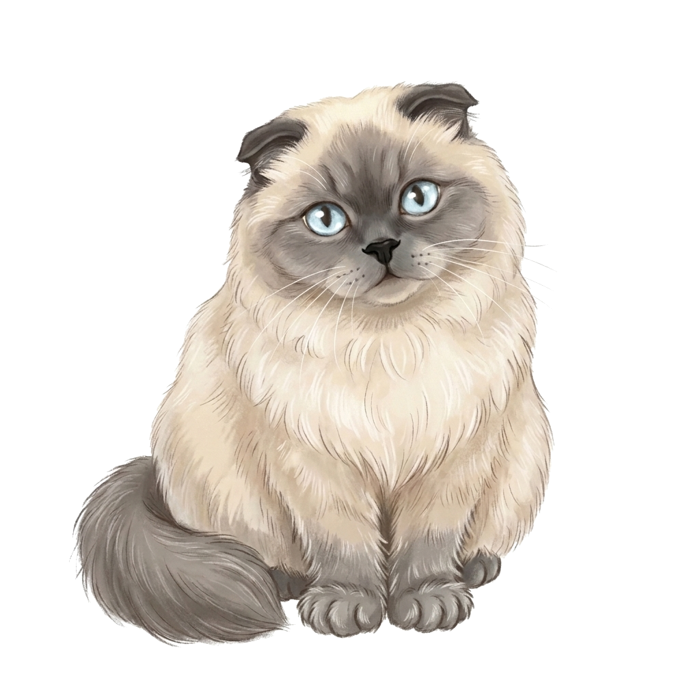

<p align="center">
  
</p>

<h1 align="center">Issue Notebook &amp; Maviş</h1>

<p align="center">
  A cozy pastel issue &amp; to-do tracker with local semantic duplicate detection, Gemini structured triage, tool-calling chat, and a frameless Windows desktop cat companion modeled after Maviş.
</p>

---

### Features
* **Issue &amp; To-Do Notebook:** FastAPI + PostgreSQL (`pgvector`) + Next.js with quick-add, status/priority symbols, labels, and `due_at` deadlines.
* **Local Duplicate Detection (Zero Rate Limits):** Embeds every issue locally with `sentence-transformers` (`all-MiniLM-L6-v2`, 384 dims) and queries `pgvector` cosine distance for live duplicate warnings while typing.
* **Threshold Tuned with Real Evals:** Evaluated with `backend/evals/eval_duplicates.py` on `sample_issues.json` — tuning the similarity cutoff to **`0.45`** separated true duplicates (`0.486`–`0.702`) from unrelated issues (`<= 0.227`) at **100% precision / 100% recall**.
* **Gemini Flash Auto-Tag (Structured JSON):** Enforces a strict Pydantic `TriageResult` schema with human-in-the-loop **Apply / Dismiss** and automatic fallback across Gemini Flash / Flash-Lite models on `503`/`429`.
* **Maviş Tool-Calling Assistant:** Natural-language assistant grounded in live PostgreSQL tools (`list_issues`, `search_issues`, `get_issue_stats`, `create_issue` with deadline parsing).
* **Maviş Desktop Pet (Electron):** Transparent, frameless, draggable cat that naps in the corner of your screen, wakes up automatically when a deadline is `< 1 hour` away, and opens a quick speech-bubble menu on click (`Ctrl + Shift + M` to hide/show).

---

### Tech Stack
* **Backend:** Python, FastAPI, SQLAlchemy 2.0, PostgreSQL + `pgvector` (Docker or Neon), `uv`, `pytest`
* **AI:** `sentence-transformers` (local embeddings), `google-genai` (Gemini Flash + Flash-Lite fallback)
* **Frontend &amp; Desktop:** Next.js, TypeScript, Tailwind CSS, Electron

---

### Quickstart

1. **Configure `.env`**
   ```powershell
   Copy-Item .env.example .env
   ```
   Fill in `DATABASE_URL` (local Docker Postgres or free Neon cloud Postgres) and `GEMINI_API_KEY`.

2. **Backend**
   ```powershell
   cd backend
   uv sync
   uv run uvicorn app.main:app --reload
   ```

3. **Frontend**
   ```powershell
   cd frontend
   npm install
   npm run dev
   ```
   Open http://localhost:3000 (full notebook) or http://localhost:3000/widget.

4. **Maviş Desktop Pet (Windows)**
   ```powershell
   cd desktop
   npm install
   npm start
   ```
   To launch Maviş automatically when Windows starts:
   ```powershell
   powershell -ExecutionPolicy Bypass -File .\install-startup.ps1
   ```

5. **Tests &amp; Duplicate Eval**
   ```powershell
   cd backend
   uv run pytest
   uv run python evals/eval_duplicates.py
   ```
